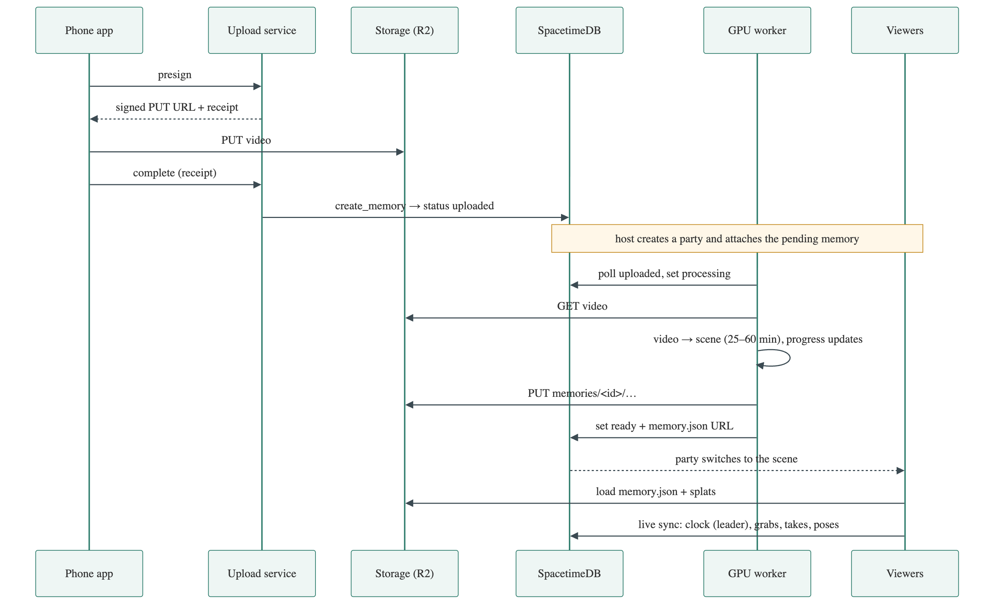

# memos: system design

**Ship the scene, sync the state.** The GPU turns the video into scene files once. Every device downloads them and renders locally. Only small shared state (clock, grabs, poses) travels live, so many people share one memory with no rendering server.

| Component | Job |
|---|---|
| **Phone app** (iOS) | Record from the glasses, upload with retry, open the viewer link |
| **Upload service** (Node) | Sign uploads, verify them, register the memory. Stateless. |
| **Object storage** (R2) | All files: raw videos and finished scenes |
| **SpacetimeDB** (Maincloud) | Memory status and links, and all live multiplayer state and rules |
| **GPU worker** (Runpod) | Pull new uploads, build the scene, publish it, report progress |
| **Viewer** (web) | One app for Quest (WebXR), phone and desktop: render, grab, throw, parties |

| # | Between | Contract |
|---|---|---|
| I1 | Glasses → phone | Meta DAT SDK 1.0.1. MP4/MOV, ≥ 1280 px, 30 fps, with audio. |
| I2 | Phone → upload service, storage | `POST /api/uploads/presign` `{identity, name, type, size, title, durationSec}` returns `{putUrl, receipt, requestId}`. Then `PUT putUrl` within 15 min. Then `POST /api/uploads/complete` `{identity, receipt}` within 60 min. Bearer = SpacetimeDB token. |
| I3 | Upload service → DB | `create_memory {requestId, title, sourceUrl, pipelineIdentity, durationUs}` creates a row with status `uploaded`. |
| I4 | Worker ↔ DB | Poll with SQL `status = 'uploaded'`, then `set_memory_status [id, status, progress, manifestUrl, error]`. Statuses: uploaded, processing, ready (or failed). |
| I5 | Worker ↔ storage | Read `videos/<owner>/<requestId>.<ext>`. Write `memories/<memoryId>/` once: `memory.json`, splats, collider, audio. |
| I6 | Viewer ← storage | Load `memory.json` (schema in `packages/shared/src/manifest.ts`). Bucket is public-read with CORS. |
| I7 | Viewer ↔ DB | WebSocket subscription. Reducers: party (`create_party`, `join_room`), time (leader only: `seek`, `set_paused`, `set_playback_speed`), interaction (`grab`, `release`), presence (`set_pose`). |

**Rules**
- Files never go in the database. The DB holds state and links; storage holds bytes.
- Clients and the worker talk to SpacetimeDB directly. There is no custom API server.
- One renderer: Quest, phone and desktop all use the web viewer.
- Change an interface on both sides in the same PR.

**Status:** upload, the pipeline, scene switching and live sync work. Glasses capture, the automatic worker and the cloud setup are not done yet.

**Next, in order**
1. Cloud setup: Maincloud database, R2 bucket, upload service and viewer on HTTPS.
2. Run the worker on Runpod and test one real upload end to end.
3. Build the phone app on a real iPhone against the DAT SDK.
4. Make the viewer's VR controls respect the party leader.
5. Record the demo clip.
