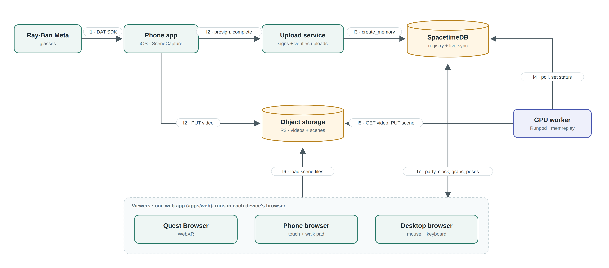
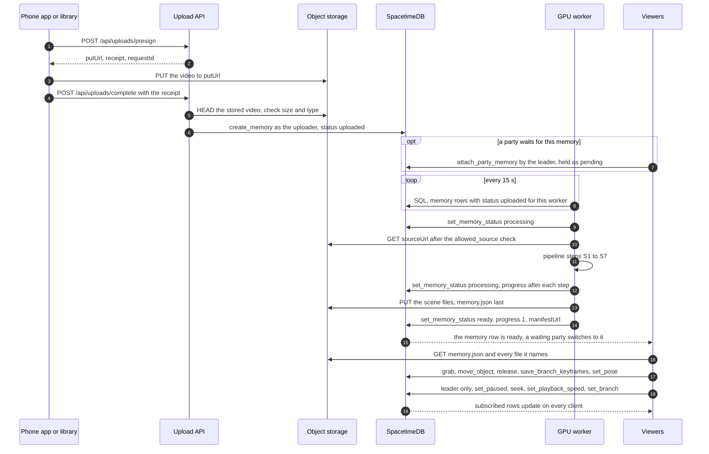

# Architecture

memos turns a short video from Ray-Ban Meta glasses (or a phone) into a 3D memory that moves over time: the room as a
Gaussian splat, the people as moving point "ghosts" and the small props as objects with physics. Friends relive it
together on a Quest 3S, a phone or a desktop browser, on one shared clock, and can pause time to grab and throw things
and branch alternate takes.

[make_arch.py](./architecture/make_arch.py) draws this diagram: `python3 docs/architecture/make_arch.py` regenerates
`arch.svg`, and the script's docstring has the headless Chrome command that renders `arch.png` from it.

## Ship the scene, sync the state

A GPU turns each video into scene files once. Every device downloads those files and renders them itself, so there is no
rendering or physics server and any number of people can share one memory. Only small shared state travels live, through
SpacetimeDB:

- the shared clock: one row per room, written only on play, pause, seek, a speed change or a take change; each client
  computes the current time from it;
- grabs: who holds or simulates which object, and its pose about 15 times a second while it is held or flying;
- recorded throws, saved once as keyframe chunks, so every client (including people who join later) replays the same
  take;
- presence: each player's head and hand positions, about 12.5 times a second.

## Components

| Component      | Job                                                           | Code                |
| -------------- | ------------------------------------------------------------- | ------------------- |
| Phone app      | Records from the glasses, keeps clips on the phone, uploads   | `apps/ios/`         |
| Upload API     | Signs and verifies uploads, registers memories, passwords     | `server/upload/`    |
| Object storage | Every file: source videos and finished scenes                 | S3, R2 or disk      |
| SpacetimeDB    | Memories, accounts, parties, the clock, takes, grabs, poses   | `server/spacetime/` |
| GPU worker     | Turns new uploads into scenes, publishes them, reports status | `pipeline/`         |
| Web app        | One viewer for Quest, phone and desktop; library; capture     | `apps/web/`         |

- **Phone app:** two Xcode projects share one SwiftUI app with Capture, Memories, Party and Settings tabs.
  `SceneCapture` records the glasses' camera through Meta's Wearables Device Access Toolkit; `SceneCaptureDemo` records
  a simulated camera. Clips stay on the phone and upload through a durable, resumable queue. See [ios.md](./ios.md).
- **Upload API:** the package `@memreplay/upload`. One request handler (`server/upload/src/handler.mjs`) runs either as
  a Node server (`server/upload/src/node/server.mjs`, with local-disk or S3/R2 storage) or on Cloudflare Workers with R2
  (`server/upload/src/cloudflare/`), where it also streams files into R2 and serves them under `/media/`. It keeps no
  upload state: receipts and upload URLs are HMAC-signed, expiring tickets. Apart from the files, the only thing it
  stores is the encrypted registry of six-digit passwords. See [upload-api.md](./upload-api.md).
- **Object storage:** an S3-compatible bucket (R2 in practice), or a folder on disk for `npm run upload:local`
  (`data/uploads` by default).
- **SpacetimeDB:** a TypeScript module for SpacetimeDB 2.13 (`server/spacetime/src/`): the tables in `schema.ts`, the
  reducers in `reducers/`. It runs locally (`npm run stdb:start`, port 3055) or on Maincloud. See
  [multiplayer.md](./multiplayer.md).
- **GPU worker:** `memreplay worker`, the Python pipeline's polling loop (`pipeline/memreplay/worker.py`), on a Runpod
  GPU pod set up by the scripts in `pipeline/runpod/`. The pipeline itself (NVIDIA ViPE, then gsplat for the room) is in
  the [pipeline runbook](../pipeline/README.md).
- **Web app:** a Vite app with three pages: the viewer (`index.html`; three.js, Spark for splats, Rapier for physics,
  WebXR for the headset), the memory library (`library.html`) and the capture test page (`capture.html`). In
  development, the Vite server proxies `/stdb` to SpacetimeDB and `/api` to the upload API, so one origin serves
  everything. See [viewer.md](./viewer.md) and [development.md](./development.md).

The scene format that connects the pipeline and the viewer lives in `packages/shared/` (TypeScript) and
`pipeline/memreplay/manifest.py` (Python): [scene-format.md](./scene-format.md). How each component is hosted:
[deployment.md](./deployment.md).

## How a memory is made and shared

1. **Record.** The iPhone app records the glasses' camera stream, or the wearer records with the glasses' own recorder
   and exports the clip through the Meta AI app. See the [recording guide](./recording-guide.md).
2. **Upload.** The app, or the web library's upload panel, asks the upload API to presign the upload, PUTs the video
   into storage and completes the upload with the signed receipt.
3. **Register.** The upload API checks the stored object's size and type and calls `create_memory` with the uploader's
   own token. The memory row appears with status `uploaded`, assigned to the GPU worker's identity.
4. **Build.** The worker polls SpacetimeDB, takes the row, sets it to `processing`, downloads the video and runs the
   pipeline, reporting progress after each step.
5. **Publish.** The worker uploads `memory.json`, `memory.static.json` and every file they reference into one folder per
   memory, `memory.json` last, then sets the row to `ready` with the manifest's public URL.
6. **Relive.** The memory's library card becomes an **Explore in 3D** link. A party leader can attach the memory to a
   party even while it is still processing: the party switches to it when it turns `ready`. Each viewer loads
   `memory.json` and its files from storage, and shares the clock, grabs and poses through SpacetimeDB.

## Interfaces

The diagram's arrows are labelled with these seven interfaces. Each one has a fixed contract; change both sides of it
together.

### I1: glasses to phone app

- **Live:** `SceneCapture` streams the glasses' camera through Meta's Wearables Device Access Toolkit (DAT) 1.0.1. It
  asks for high resolution at 30 fps with 44.1 kHz mono audio and writes an H.264 + AAC MP4 (`Recorder.swift`). A
  recording stops after 90 seconds.
- **Exported:** the glasses' own recorder, exported through the Meta AI app (MOV on iPhone, MP4 on Android). The phone
  app imports it (**Import glasses MP4 / MOV**), or the web library uploads it.
- **Checks:** before queueing a clip for reconstruction, the app requires at least 1280 px on the long edge, a frame
  rate of about 24 fps or more and a non-empty audio track (`apps/ios/SceneCapture/CaptureRequirements.swift`). The
  pipeline resamples every clip to 30 fps. Recording advice: [recording-guide.md](./recording-guide.md).

### I2: phone or browser to upload API and storage

Every call carries `Authorization: Bearer …`: either a `memos1.` session credential from the account routes, or a raw
SpacetimeDB token with the matching `identity` in the request.

1. `POST /api/uploads/presign` with `{identity, name, type, size, title, durationSec, pipeline}` returns
   `{putUrl, headers, receipt, requestId, sourceUrl, pipeline, expiresIn, receiptExpiresAt}`. The API accepts MP4, MOV
   and WebM (`video/mp4`, `video/quicktime`, `video/webm`), a title of 1–120 characters, a duration of up to an hour and
   a size of up to the server's `maxUploadBytes` (2 GiB by default; 90 MiB on Cloudflare Workers). `pipeline: false`
   marks a test upload: its row is assigned to the uploader, so the worker never takes it. `pipeline: true` fails with
   503 when no worker is configured, and an omitted `pipeline` means "reconstruct if a worker is configured";
   `GET /api/account/config` reports this as `pipelineAvailable`.
2. `PUT putUrl` with exactly the returned headers (the `Content-Type` is signed), within 15 minutes. `putUrl` is a
   presigned bucket URL (S3/R2), the API's own `/api/uploads/put` (Cloudflare Workers) or `/api/local-upload` (local
   disk).
3. `POST /api/uploads/complete` with `{identity, receipt}`, within the receipt's hour, returns
   `{requestId, status, pipeline, memory}`. The API checks the stored object's size and type, then registers the memory
   (I3). Completion is idempotent: retry it with the same receipt.

Videos are stored at `videos/<owner identity>/<requestId>.<ext>`, and the row's `sourceUrl` points there. The account
routes (six-digit passwords) and the other routes are in [upload-api.md](./upload-api.md).

### I3: upload API to SpacetimeDB

The upload API calls `create_memory` through SpacetimeDB's HTTP API with the uploader's token, so the row's `owner` is
the uploader. Arguments: `{requestId, title, sourceUrl, manifestUrl, pipelineIdentity, durationUs}`, where
`pipelineIdentity` is the worker's identity (`PIPELINE_IDENTITY`) for a real upload, or the uploader's own for a test
upload. The row starts as `uploaded` with progress 0. A repeated `requestId` with the same arguments is a no-op, so a
retried completion never creates a second memory.

The same reducer registers a finished scene: with a `manifestUrl` and no `sourceUrl`, the memory is `ready` at once. The
viewer's **Add to library** and the library's **Publish scenes** work this way.

### I4: GPU worker and SpacetimeDB

- **Poll:** every 15 seconds, over SpacetimeDB's HTTP SQL API with `PIPELINE_TOKEN`:
  `SELECT * FROM memory WHERE status = 'uploaded'`. The worker keeps the rows whose `pipeline_identity` is its own
  `PIPELINE_IDENTITY` and skips rows assigned to their own owner (test uploads).
- **Report:** `set_memory_status [memoryId, status, progress, manifestUrl, error]`, after each pipeline step.
- **Rules in the module:** only the row's `pipelineIdentity` may set its status. The transitions are
  `uploaded → processing | failed`, `processing → processing | ready | failed`, `failed → processing` (a retry) and
  `ready → ready`. Progress stays within 0–1 and never goes backwards while processing. `ready` needs an http(s)
  `manifestUrl` and progress exactly 1.
- **Hand-off:** when a memory turns `ready`, every party waiting on it (through `attach_party_memory`) switches to it,
  paused at the start.

Run one worker per worker identity: setting a row to `processing` is the only claim on it, so two workers polling at the
same moment can take the same row. Worker settings: [pipeline runbook](../pipeline/README.md) and
[upload-api.md](./upload-api.md).

### I5: GPU worker and storage

- **Read:** the worker downloads `sourceUrl` only if `allowed_source()` in `pipeline/memreplay/source_check.py` accepts
  it: an upload key `videos/<owner>/<uuid>.<mp4|mov|webm>` directly under `ASSET_BASE_URL` (or under
  `PUBLIC_ORIGIN/api/local-media` for the local upload API), owned by the row's owner. Any client can call
  `create_memory` with any `sourceUrl`, so the worker trusts none. Downloads are capped at 2 GiB and a time limit, and
  never follow redirects.
- **Write:** `memory.json`, `memory.static.json` and every file they reference, once, into one folder per memory named
  `<memoryId>-<requestId>`, with `memory.json` written last. The publisher depends on the worker's settings:
  - `MEMREPLAY_UPLOAD_API`: through the upload API's worker routes (`/api/pipeline/assets/start`, `part`, `complete`,
    `abort`) in 16 MiB parts, into `scenes/<memoryId>-<requestId>/` in R2. The GPU pod needs no bucket credentials.
  - `S3_BUCKET`: straight into the bucket, under `memories/<memoryId>-<requestId>/`, with each file's content type set.
  - `MEMREPLAY_PUBLISH_DIR` and `MEMREPLAY_PUBLIC_BASE_URL`: into a folder. The local upload API serves its scene folder
    (`LOCAL_SCENE_DIR`) at `/api/local-scenes/`.

### I6: viewer from storage

The viewer fetches `memory.json` from the memory's `manifestUrl` (or from `?memory=<url>`), validates it, and loads
every file it names relative to the manifest's own URL. The contract is [scene-format.md](./scene-format.md). Storage
must serve the files to every viewer: from the same origin (`/media/` on Cloudflare Workers, `/api/local-scenes/`
locally), or from a public bucket whose CORS policy allows `GET` and `HEAD` from the viewer's origin, with the right
content types and byte ranges.

### I7: viewer and SpacetimeDB

The web app connects over a WebSocket with the `spacetimedb` 2.13.0 browser SDK (bindings generated into
`apps/web/src/module_bindings/` by `npm run stdb:generate`) and subscribes to the public tables `memory`, `room`,
`party`, `profile`, `player`, `timeline`, `branch`, `object_state`, `branch_keyframes` and `clock_sample`. Reducers:

- **Sign-in:** `register_account` binds a name to the caller's identity (a registered name is then fixed);
  `set_display_name` labels a guest. Clients register through the upload API's `/api/account`, which calls
  `register_account` with their token and issues the six-digit password that restores the identity on another device.
- **Library:** `create_memory` with a manifest URL (I3).
- **Rooms and parties:** `create_party` (a room with a leader; `create_room` makes one without), `join_room` with a
  seven-character code, `leave_room`, `transfer_leadership` and `attach_party_memory` (switch the party's scene; a
  memory that is still processing waits as pending).
- **Time:** `set_paused`, `seek`, `set_playback_speed`, `set_branch` and `fork_branch`, leader only in a party;
  `sample_clock` calibrates each client's clock offset.
- **Objects:** `grab` (only while paused), `move_object`, `release` and `save_branch_keyframes` (a thrown object's
  recorded flight, in chunks of up to 120 keyframes).
- **Presence:** `set_pose`, the head and hand positions for avatars.

Wire and SQL names are snake_case (`create_party`); the TypeScript bindings are camelCase (`conn.reducers.createParty`).
The rules behind grabs, takes and leadership, and how the viewer's network adapter uses them:
[multiplayer.md](./multiplayer.md).

## Design rules

- **Files never go in the database.** SpacetimeDB holds state and links; storage holds the bytes.
- **No custom realtime server.** All shared state and its rules live in the SpacetimeDB module. The web app and the GPU
  worker talk to SpacetimeDB directly; the iPhone app reaches it through the upload API, which calls it with the user's
  own token. The upload API only does what a database can't: signed uploads, file transfer and passwords.
- **One renderer.** The Quest, phones and desktops all run the same web viewer.
- **A contract changes on both sides together:** `manifest.ts` and `manifest.py` in one commit; a reducer and its
  regenerated bindings (`npm run stdb:generate`; never edit `module_bindings/` by hand); an upload API route and its
  callers (the web app, the iPhone app and the worker's publisher).
- **SpacetimeDB module code is deterministic:** `ctx.random` and `ctx.timestamp`, never `Math.random()` or `Date.now()`.

## Design decisions

- **One web app for every device, not Unity.** The Quest Browser, phones and desktops open the same URL, which gives
  sharing and cross-device parties for free. A Unity build would need a separate phone build, and Gaussian splats in
  Unity on Quest were unproven.
- **Plain three.js, not Meta's Immersive Web SDK.** The SDK's built-in grab, locomotion and physics would save code, but
  it pins its own three.js build, which Spark would have to share. Grab, throw and locomotion are written directly on
  three.js and Rapier (`apps/web/src/engine/`, `apps/web/src/xr/`).
- **A layered scene, not full 4D Gaussian splatting.** The room is one static splat trained on every frame, so it is the
  sharpest part. People are per-frame coloured points, and each prop is its own splat with a simple collider and a
  measured position track. Per-scene 4D splatting trains for a long time, is fragile on head-mounted video and gives no
  colliders, so no physics. A parallel experiment confirmed the trade-off: real 4D splatting matches the video far
  better from the recorded camera, but its whole room wobbles, its files are large and nothing in it can be grabbed
  ([reports/4dgs.md](./reports/4dgs.md)).
- **One clip and NVIDIA ViPE for the camera solve, no room sweep.** One model gives the camera path, the lens, metric
  depth for every pixel and per-frame instance masks. The glasses have one camera, so depth comes from the wearer's own
  movement (ViPE triangulates across time) plus a metric depth model for scale. Solvers that assume a static scene do
  not fit a moving moment, and a separate room sweep would need registering two clips and breaks the "footage you
  already shot" idea. ViPE's own masks, prompted with single words, find the people and props, so no separate
  segmentation model is needed.
- **One rented GPU with two Python environments.** ViPE and gsplat build CUDA code and are debugged over SSH, so the
  pipeline runs on a Runpod pod with a persistent volume: `world` (the `memreplay` code, ffmpeg, gsplat) and `vipe`
  (ViPE in its own uv environment).
- **SpacetimeDB for all shared state.** Rooms, avatars, the shared clock, grab ownership and takes map directly onto
  tables and reducers, and clients get every change through subscriptions.
- **The clock is an anchor, not a stream.** A room's `timeline` row holds `anchorMediaUs`, `anchorServerTs`, `speed` and
  `paused`. Each client computes `t = anchorMediaUs + (now − anchorServerTs) × speed` after calibrating its offset with
  `sample_clock`, so the clock costs nothing per frame.
- **The thrower's device simulates, the server arbitrates.** `grab` succeeds only if nobody else holds or simulates the
  object. The holder streams poses and simulates the throw until the object rests, then saves the flight as keyframe
  chunks. There is no server physics tick and no lockstep. Catching an object that another player is still simulating is
  refused, so every throw has one author.
- **Takes never change once recorded.** Grabbing on the original recording forks a take named "First edit"; grabbing an
  object that already rests on a take forks "Edit `<id>`". Takes are never deleted, and the server copies nothing into a
  child take: the client works out what a take inherits from its parents.
- **A party has one leader for time and scene.** Only the leader plays, pauses, seeks, changes speed, switches takes or
  changes the scene, so a group follows one timeline; everyone can grab while time is paused. Leadership passes with
  `transfer_leadership`, or to another connected member when the leader leaves.
- **Names and six-digit passwords instead of a third-party login.** A name is a label bound to a SpacetimeDB identity.
  The upload API issues a six-digit password that restores that identity on the phone, the web and the Quest, and keeps
  the password registry encrypted in storage, never in a public table.
- **One repository.** The scene format, the viewer, the server module, the upload API, the iPhone app and the pipeline
  change together.

## Limitations

- **Everything is public.** Every table the clients subscribe to is public, including each memory's `sourceUrl` and
  `manifestUrl`, and anyone with a video or scene URL can read it. Party codes are invitations, not access control.
  Private memories would need scoped subscriptions and authorized asset URLs.
- **No job locking or crash recovery.** A worker stopped mid-job leaves its memory in `processing`, and workers only
  take `uploaded` rows.
- **Light upload checks.** The upload API checks only the file type, size and duration. Resolution, frame rate and audio
  are checked only by the iPhone app; the web upload checks none of them.
- **Durations must agree.** A memory's `durationUs` is set when it is registered (from the uploaded video's duration)
  and bounds seeks and recorded keyframes. The scene's `timeline.durationSec` should match it.
- **The real pipeline path has one test.** `npm run test:pipeline` and `npm run test:connections` substitute the
  reconstruction stages; only `npm run test:pipeline:live` runs a real GPU job end to end, and it needs a running
  worker.
- **No headset measurements.** The viewer has not been run on a Quest 3S, so its frame rate, controller feel and ghost
  performance there are unmeasured.
- Open issues in multiplayer edge cases (takes, late joiners, reloads mid-throw) are listed in
  [multiplayer.md](./multiplayer.md).
